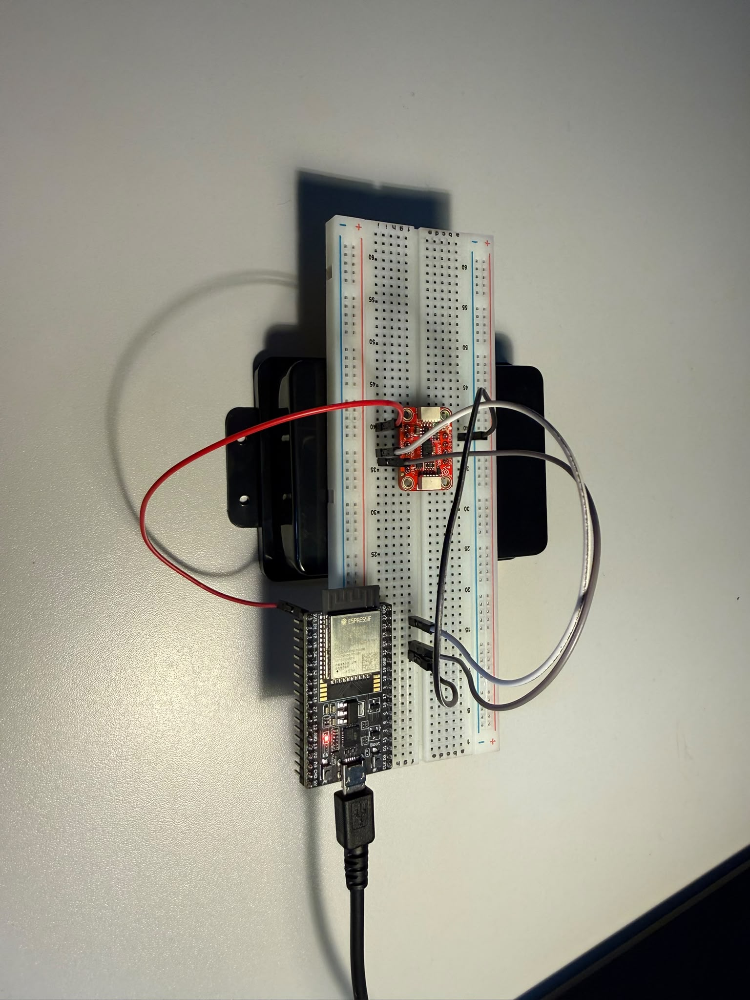
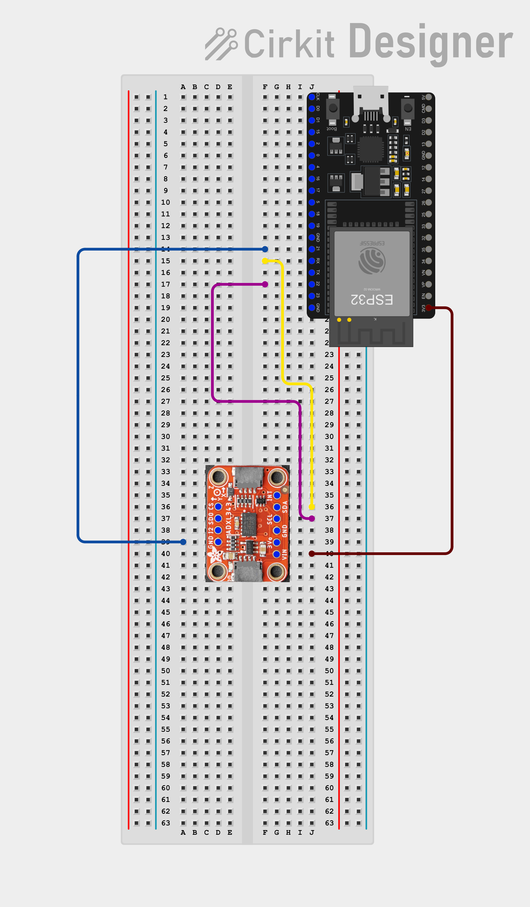

# Adafruit Test

Im Abschnitt `001-adafruit-test` wird der **Adafruit ADXL343** Accelerometer getestet.

## Durchfuehrung

Der **Adafruit ADCL343** wird an den **ESP32** angeschlossen. Dies bietet den ersten Einblick welche Werte der Accelerometer ausgibt. Damit kann spaeter bestimmt werden wie der *Offset-Fehler* und *Skalierungs-Fehler* aussieht.

## Aufbau

### Prototyp:

### Schaltplan:

## Ergebnisse

Die Werte des **Adafruit ADCL343** befinden sich im Ordner `./bilder`. Dort sind einmal Werte mit und ohne Bewegung aufgenommen.

## Fazit