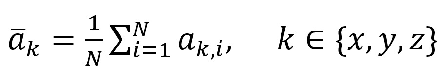

# Kalibrierter Adafruit

In diesem Schritt wird der Offset des **ADXL343** berechnet und abgezogen.  

## Uebersicht

Datei|Beschreibung
-|-
`adafruit-kalibriert.ino`|Sketch fuer das auslesen von Sensorwerten mit abgezogenen Offset
`offset.py`|Skript welcher den Offset aus den Sensordaten von 001 berechnet
`adafruit-kalibrierte-werte-ruhend.csv`|Neuen Sensor Werte mit abzug des Offset

## Offset

Der Offset ist ein Wert der sich immer gleich aufsummiert. Das `offset.py` Skript berechnet diesen mittels der Daten aus Schritt *001*. Dafuer wird der Mittelwert jeder Achse gebildet und mit den bekannten Sollwert subtrahiert.

*Voraussetzung*: Die Werte muessen in einer Stilllage aufgenommen wurden sein. Zwei Achsen muessen ruhen und eine muss senktrecht anch unten zeigen.

## Rauschen

Die Werte, welche nach dem entfernen des Offset auftauchen, zeigen das Rauschen des Sensors. Dieses Rauschen ist mal posetiv mal negativ, hebt sicht aber zum grossteil auf.

## Fazit

Die Werte der senkrechten Achse des **ADXL343** kommen jetzt viel naeher an den tatsaechlichen Wert der Erdbeschleunigung (rund *9,81 m/s^2*) dran.

---
**Naechster Abschnitt**: Erkennung von Ruhe und Bewegung.